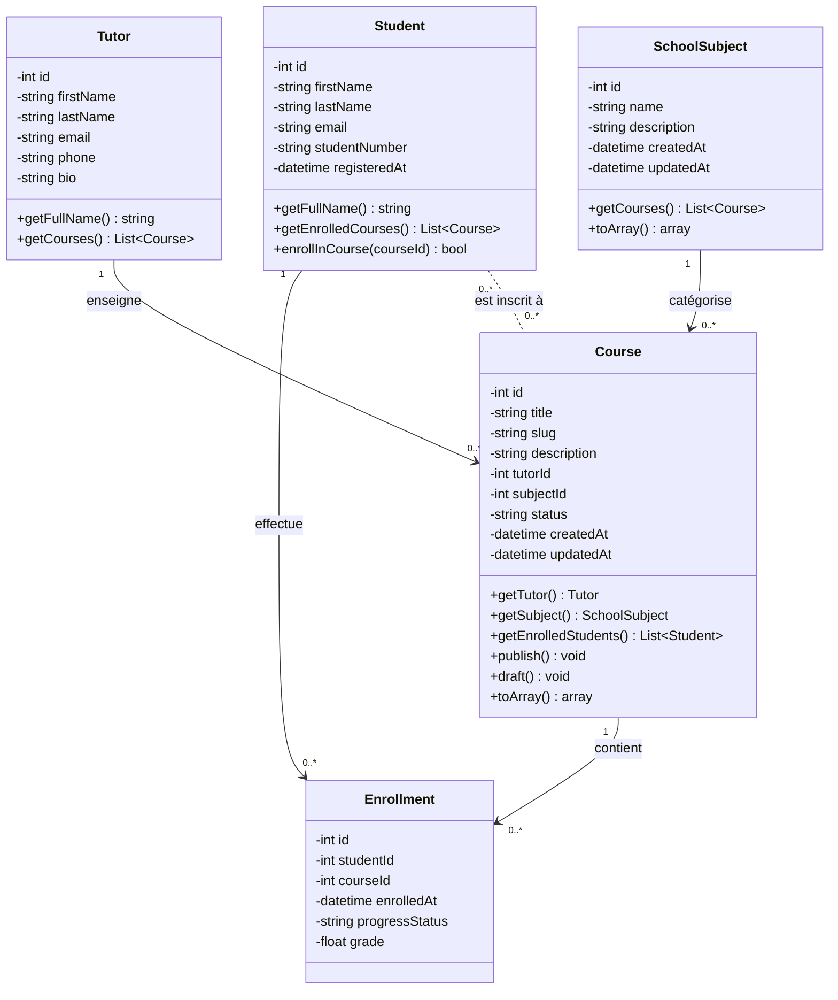
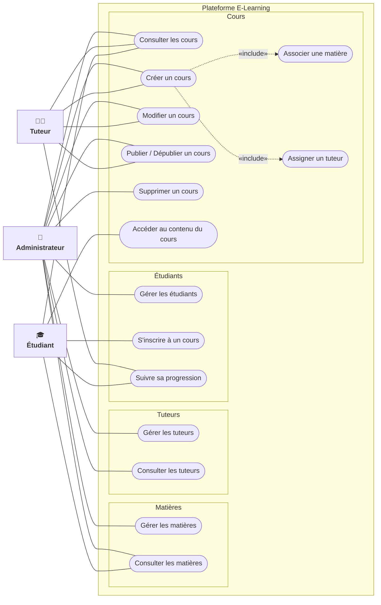

# Diagrammes de Cas d'Utilisation & Diagramme de Classes (avec Student)

## 1. Diagramme de Cas d'Utilisation (Use Case Diagram avec Stickmans)

```mermaid
flowchart LR
    %% Acteurs sous forme de Stickmans natifs Mermaid
    Admin@{ shape: actor, label: "Administrateur" }
    Tutor@{ shape: actor, label: "Tuteur" }
    Student@{ shape: actor, label: "Étudiant" }

    %% Système
    subgraph System ["Plateforme E-Learning"]
        direction TB

        %% Gestion des Matières
        subgraph Subjects ["Matières (School Subjects)"]
            UC_Sub_Manage(["Gérer les matières<br/>(Ajouter, Modifier, Supprimer)"])
            UC_Sub_List(["Consulter les matières"])
        end

        %% Gestion des Tuteurs
        subgraph Tutors ["Tuteurs (Tutors)"]
            UC_Tut_Manage(["Gérer les tuteurs<br/>(Ajouter, Modifier, Supprimer)"])
            UC_Tut_List(["Consulter la liste des tuteurs"])
        end

        %% Gestion des Étudiants
        subgraph Students ["Étudiants (Students)"]
            UC_Std_Manage(["Gérer les étudiants<br/>(Inscriptions, Profils)"])
            UC_Std_Enroll(["S'inscrire à un cours"])
            UC_Std_Track(["Suivre sa progression"])
        end

        %% Gestion des Cours
        subgraph Courses ["Cours (Courses)"]
            UC_Crs_List(["Consulter le catalogue des cours"])
            UC_Crs_Create(["Créer un cours"])
            UC_Crs_Edit(["Modifier un cours"])
            UC_Crs_Status(["Changer le statut<br/>(Brouillon / Publié)"])
            UC_Crs_Delete(["Supprimer un cours"])
            UC_Crs_ViewContent(["Accéder aux leçons & ressources"])

            UC_Assign_Sub(["Associer une matière"])
            UC_Assign_Tut(["Assigner un tuteur"])
        end
    end

    %% Relations Administrateur
    Admin --- UC_Sub_Manage
    Admin --- UC_Sub_List
    Admin --- UC_Tut_Manage
    Admin --- UC_Tut_List
    Admin --- UC_Std_Manage
    Admin --- UC_Crs_Create
    Admin --- UC_Crs_Edit
    Admin --- UC_Crs_Status
    Admin --- UC_Crs_Delete
    Admin --- UC_Crs_List

    %% Relations Tuteur
    Tutor --- UC_Crs_List
    Tutor --- UC_Crs_Create
    Tutor --- UC_Crs_Edit
    Tutor --- UC_Crs_Status
    Tutor --- UC_Std_Track

    %% Relations Étudiant
    Student --- UC_Crs_List
    Student --- UC_Sub_List
    Student --- UC_Std_Enroll
    Student --- UC_Crs_ViewContent
    Student --- UC_Std_Track

    %% Relations d'inclusion (include)
    UC_Crs_Create -.->|«include»| UC_Assign_Sub
    UC_Crs_Create -.->|«include»| UC_Assign_Tut
```

---

## 2. Diagramme de Classes UML (avec Student)



---

## 3. Version Cas d'Utilisation compatible universelle (Emojis)


