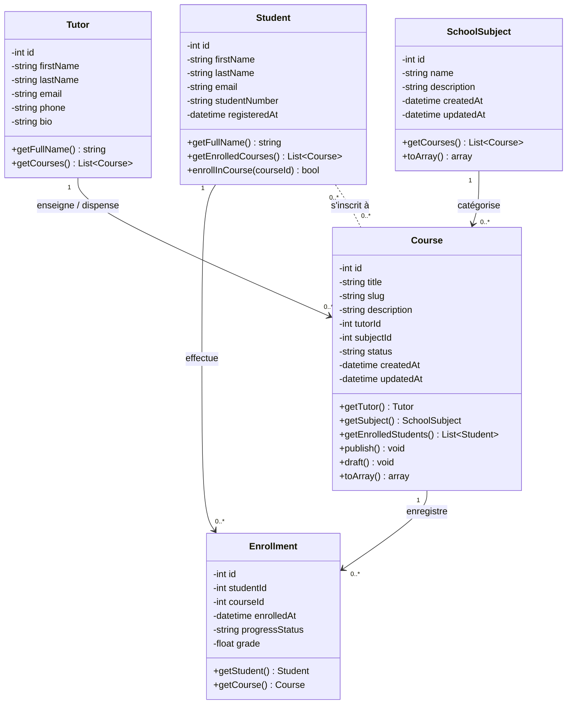
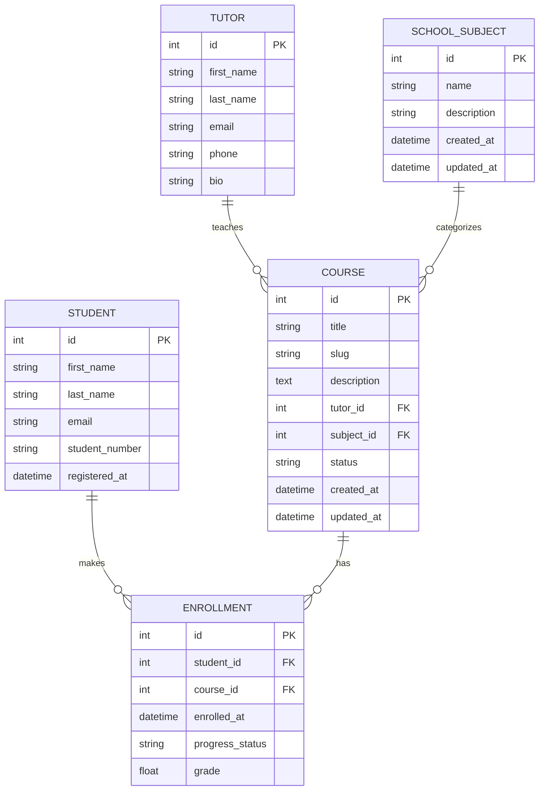

# Diagramme de Classes UML (Mermaid)

Ce diagramme modélise l'architecture des classes du système avec les 4 entités : **Tutor**, **SchoolSubject**, **Course**, et **Student** (ainsi que la classe d'association **Enrollment**).

---

## Modèle Physique des Données / ER Diagram (Optionnel)

Pour référence avec les clés primaires (PK) et clés étrangères (FK) :

